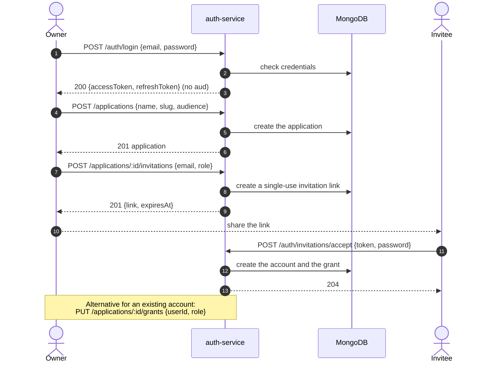

# Bootstrap an application

This flow prepares everything an integrator needs before the first login: an
application, and a user with access to it. Only the global owner can run it.

At the end you have a `slug` (or `audience`) to send as `application` on
`POST /auth/login` and a user that is allowed to log in with it.

## Before you start

The local stack must be running: follow [Getting started](README.md) and check
that `GET /health` answers `200`. You also need the owner credentials from
`.env` (`OWNER_EMAIL`/`OWNER_PASSWORD`).

## Access levels used here

Every route in this repository belongs to one of four levels, and they do not
mix: an application token is not accepted where an owner token is required.

| Route                                     | Access    |
| ----------------------------------------- | --------- |
| `POST /auth/login` (no `application`)     | Public    |
| `POST /applications`                      | Owner     |
| `POST /applications/:id/invitations`      | App admin |
| `PUT /applications/:applicationId/grants` | App admin |
| `POST /auth/invitations/accept`           | Public    |
| `GET /applications`                       | Owner     |

`App admin` means the owner or a user whose grant on that application is
`admin`.

## Flow at a glance



## 1. Let the owner be provisioned

The owner comes from the environment, so it only exists if the service starts
with both values set:

```dotenv
# .env
OWNER_EMAIL=owner@home.example
OWNER_PASSWORD=ChangeMe123!
```

`OWNER_PASSWORD` must have at least 8 characters, one lowercase letter, one
uppercase letter, one digit and one symbol. With anything weaker the process
stops at startup with `Password does not meet complexity requirements` and no
owner is created. `.env.example` ships both lines commented out, so uncomment
them and restart `pnpm dev`.

Provisioning is idempotent: restarting with the same email never creates a
second owner and never rotates the password.

## 2. Log in as the owner

The owner is the only account that can log in without an `application`:

```bash
curl -s -X POST http://localhost:3000/auth/login \
  -H 'Content-Type: application/json' \
  -d '{"email":"owner@home.example","password":"ChangeMe123!"}'
```

```json
{
  "accessToken": "eyJhbGciOiJSUzI1NiIs...",
  "refreshToken": "eyJhbGciOiJSUzI1NiIs..."
}
```

The owner token carries no `aud`, and it is the only token accepted by
`/users`, `/applications` and `/audit-events`. Keep it out of any client that
end users can inspect.

Export it for the next steps:

```bash
OWNER_TOKEN="<accessToken from the response>"
```

## 3. Create the application

```bash
curl -s -X POST http://localhost:3000/applications \
  -H "Authorization: Bearer $OWNER_TOKEN" \
  -H 'Content-Type: application/json' \
  -d '{"name":"Docs Demo","slug":"docs-demo","audience":"docs-demo"}'
```

```json
{
  "name": "Docs Demo",
  "slug": "docs-demo",
  "audience": "docs-demo",
  "active": true,
  "_id": "65f1c0a2b7d4e90012a3b4c5",
  "createdAt": "2026-01-01T10:00:00.000Z",
  "updatedAt": "2026-01-01T10:00:00.000Z",
  "__v": 0
}
```

- `slug` is kebab-case: lowercase letters and digits separated by single
  hyphens.
- `audience` ends up in the `aud` claim of every token issued for this
  application, so it is what a backend uses to validate the token.
- Both `slug` and `audience` are accepted as the `application` value on login.

Keep the `_id`:

```bash
APP_ID="<_id from the response>"
```

## 4. Give a user access

There are two paths, and both end with an active grant on the application.

### 4a. Invite someone who does not have an account yet

```bash
curl -s -X POST "http://localhost:3000/applications/$APP_ID/invitations" \
  -H "Authorization: Bearer $OWNER_TOKEN" \
  -H 'Content-Type: application/json' \
  -d '{"email":"editor@example.com","role":"editor"}'
```

```json
{
  "link": "http://localhost:3000/invitations/accept?token=RdvQBMp0X6eBTEuw50LTAqbuXNcy0dF7d2B2DF9niwM",
  "expiresAt": "2026-01-08T10:00:00.000Z",
  "email": "editor@example.com",
  "applicationId": "65f1c0a2b7d4e90012a3b4c5",
  "role": "editor",
  "notification": { "delivered": false, "recipient": null }
}
```

The link is single-use, expires after `INVITATION_LINK_EXPIRATION_MS` (7 days
by default) and carries the token in the `token` query parameter. Share it out
of band: `notification.delivered` is `false` unless Telegram is configured.

The invited person accepts it and sets a password:

```bash
curl -s -o /dev/null -w '%{http_code}\n' \
  -X POST http://localhost:3000/auth/invitations/accept \
  -H 'Content-Type: application/json' \
  -d '{"token":"<token from the link>","password":"Editor123!","passwordConfirmation":"Editor123!"}'
```

`204` with no body. The account is created already verified and with the role
from the invitation.

### 4b. Grant an existing account

If the person already has an account, the owner (or an app admin) writes the
grant directly:

```bash
curl -s -X PUT "http://localhost:3000/applications/$APP_ID/grants" \
  -H "Authorization: Bearer $OWNER_TOKEN" \
  -H 'Content-Type: application/json' \
  -d '{"userId":"65f1c0a2b7d4e90012a3b4c6","role":"viewer"}'
```

```json
{
  "_id": "65f1c0a2b7d4e90012a3b4c7",
  "applicationId": "65f1c0a2b7d4e90012a3b4c5",
  "userId": "65f1c0a2b7d4e90012a3b4c6",
  "role": "viewer",
  "createdAt": "2026-01-01T10:05:00.000Z",
  "updatedAt": "2026-01-01T10:05:00.000Z",
  "__v": 0
}
```

Roles are `viewer`, `editor` and `admin`. The call upserts: sending the same
`userId` again changes the role instead of failing.

`GET /applications/:applicationId/grants` lists who has access and
`DELETE /applications/:applicationId/grants/:userId` revokes it.

## 5. Check that the access works

Log in as the invited user with the application:

```bash
curl -s -X POST http://localhost:3000/auth/login \
  -H 'Content-Type: application/json' \
  -d '{"email":"editor@example.com","password":"Editor123!","application":"docs-demo"}'
```

A `200` with `accessToken` and `refreshToken` means the grant is active. The
token belongs to that application and carries its role:

```json
{
  "userId": "65f1c0a2b7d4e90012a3b4c6",
  "role": "editor",
  "type": "access",
  "aud": "docs-demo",
  "sub": "65f1c0a2b7d4e90012a3b4c6",
  "iss": "auth-service",
  "jti": "2d1c9a3e-4b8f-4a51-9c0e-7f6b5a4d3c2b",
  "iat": 1767261600,
  "exp": 1767265200
}
```

## Troubleshooting

| Symptom                                                                                   | Cause                                                                                             |
| ----------------------------------------------------------------------------------------- | ------------------------------------------------------------------------------------------------- |
| Startup fails with `Password does not meet complexity requirements`                       | `OWNER_PASSWORD` lacks an uppercase letter, a lowercase letter, a digit, a symbol or 8 characters |
| `403 {"message":"User has no access to this application","code":"FORBIDDEN"}`             | The account exists but has no grant on that active application                                    |
| `401 {"message":"Invalid email or password","code":"INVALID_CREDENTIALS"}`                | The application is unknown or inactive: the password is verified first and the response collapses |
| `401 {"message":"Invalid token payload","code":"INVALID_CREDENTIALS"}` on `/applications` | You sent an application token: those routes need the owner token                                  |
| `429` on `/auth/login`                                                                    | `RATE_LIMIT_LOGIN_MAX` attempts per window; restart the stack or wait out the window              |
| `400 {"message":"The link is invalid, used or expired","code":"INVALID_LINK"}`            | The link was already used, expired or the token was altered; create a new invitation              |

## What's next

The application and the grant are ready. Continue with [Sign up and verify an
email](signup-and-verification.md) if the account does not exist yet, then with
[Log in, call the API and refresh the token](login-and-refresh.md) to obtain and
use the application tokens. The [API reference](../../README.md#api-reference)
lists every route and its access level.
