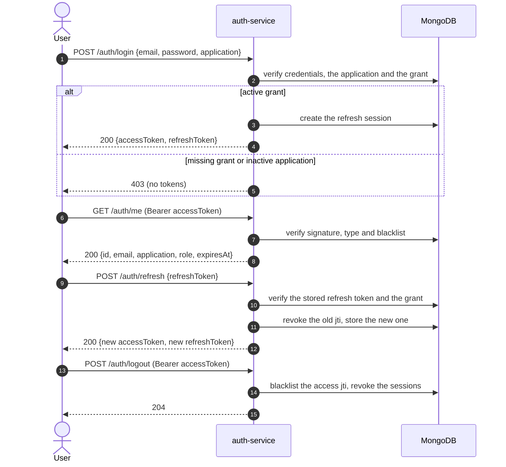

# Log in, call the API and refresh the token

This flow turns credentials into a session scoped to one application, uses the
access token against an authenticated route, rotates the refresh token and ends
the session. It is the flow every client repeats on startup and whenever the
access token expires.

Before starting you need an application, an account with a grant on it and a
verified email: follow [Bootstrap an application](application-bootstrap.md) and,
if the account does not exist yet, [Sign up and verify an
email](signup-and-verification.md).

## Access levels used here

| Route                | Access        | Notes                                                    |
| -------------------- | ------------- | -------------------------------------------------------- |
| `POST /auth/login`   | Public        | Rate-limited; needs `application` for non-owner accounts |
| `GET /auth/me`       | Authenticated | Accepts owner and application tokens                     |
| `POST /auth/refresh` | Public        | Rate-limited; rotates the refresh token                  |
| `POST /auth/logout`  | Authenticated | Blacklists the current access token                      |

`Public` means no token is sent. `Authenticated` means any valid access token:
the owner token without `aud`, or an application token with the `aud` of its
application. Neither `/auth/refresh` nor `/auth/logout` accepts the refresh
token in the `Authorization` header.

## Flow at a glance



## 1. Log in with the application

Send the email, the password and the application slug (or audience):

```bash
curl -s -X POST http://localhost:3000/auth/login \
  -H 'Content-Type: application/json' \
  -d '{"email":"editor@example.com","password":"Editor123!","application":"docs-demo"}'
```

```json
{
  "accessToken": "eyJhbGciOiJSUzI1NiIs...",
  "refreshToken": "eyJhbGciOiJSUzI1NiIs..."
}
```

- `200` with exactly two fields: the access token is short-lived
  (`JWT_EXPIRATION`, one hour with `.env.example`), the refresh token lasts
  `JWT_REFRESH_EXPIRATION` (24 hours).
- The account needs an active grant on that application. A missing or inactive
  application and a revoked grant return the same
  `403 User has no access to this application`, so the route cannot be used to
  enumerate applications.
- Without `application`, only the global owner can log in. Any other account
  gets `403 An application is required`.
- Invalid credentials return the same `401 Invalid email or password` on every
  attempt, whether the email exists or not. After `MAX_LOGIN_ATTEMPTS` (5 with
  `.env.example`) wrong passwords the account is locked for
  `LOCKOUT_DURATION_MS` (15 minutes) and login answers
  `423 Account is temporarily locked. Please try again later.` until the lock
  expires, even with the right password.

Keep both tokens:

```bash
ACCESS_TOKEN="<accessToken from the response>"
REFRESH_TOKEN="<refreshToken from the response>"
```

### What the access token carries

Decoding the payload (without verifying it) shows the application and the role
that the grant gave the account:

```json
{
  "userId": "65f1c0a2b7d4e90012a3b4c6",
  "role": "editor",
  "type": "access",
  "aud": "docs-demo",
  "sub": "65f1c0a2b7d4e90012a3b4c6",
  "iss": "auth-service",
  "jti": "2d1c9a3e-4b8f-4a51-9c0e-7f6b5a4d3c2b",
  "iat": 1767261600,
  "exp": 1767265200
}
```

`aud` is the application **audience**, not the slug, and `role` is the grant
role (`viewer`, `editor` or `admin`). Your backend validates the signature with
the keys published at `GET /.well-known/jwks.json` and checks `aud` before
trusting the token. An owner token has no `aud` and must never be accepted by an
application backend.

Never decode the token to make authorization decisions without verifying the
signature first, and keep the owner token out of any client end users can
inspect.

## 2. Call an authenticated endpoint

Send the access token as a Bearer token:

```bash
curl -s http://localhost:3000/auth/me \
  -H "Authorization: Bearer $ACCESS_TOKEN"
```

```json
{
  "id": "65f1c0a2b7d4e90012a3b4c6",
  "email": "editor@example.com",
  "application": "docs-demo",
  "role": "editor",
  "expiresAt": "2026-01-01T11:00:00.000Z"
}
```

- `200` confirms the token is valid, belongs to a live user and was not
  blacklisted.
- `application` is the audience of the presented token, or `null` for the owner.
- `role` is the role carried by the token, not re-read from the database.
- A missing header returns `401 Invalid or missing authorization header`. A
  malformed, tampered or expired token returns `401 INVALID_TOKEN`. A refresh
  token used as an access token, or a token blacklisted by logout, returns
  `401 Invalid token payload`.

Any other authenticated route behaves the same way. The access level still
matters: a valid application token is rejected with `403` on owner routes such
as `/users`, `/applications` and `/audit-events`.

## 3. Refresh the tokens

Exchange the refresh token for a new pair before the access token expires:

```bash
curl -s -X POST http://localhost:3000/auth/refresh \
  -H 'Content-Type: application/json' \
  -d "{\"refreshToken\":\"$REFRESH_TOKEN\"}"
```

```json
{
  "accessToken": "eyJhbGciOiJSUzI1NiIs...",
  "refreshToken": "eyJhbGciOiJSUzI1NiIs..."
}
```

Rotation rules:

- The refresh token is single-use. The previous one is revoked on success, so a
  retry with the old value fails with
  `401 Refresh token has been revoked`.
- The new access token repeats the same `aud`, but the role is resolved again
  from the current grant: a promotion or demotion applies on the next refresh.
- The grant and the application are re-checked. If the grant was revoked or the
  application was deactivated, the session is revoked and the refresh fails with
  `403`; the client must log in again.
- The session id is kept, so `GET /auth/sessions` shows one session across
  rotations.
- Two clients refreshing at the same time race: one wins and the other gets
  `401`, because only the stored jti can be rotated once.

Replace the stored values with the new ones:

```bash
ACCESS_TOKEN="<new accessToken>"
REFRESH_TOKEN="<new refreshToken>"
```

## 4. Log out

Logout needs the access token, not the refresh token:

```bash
curl -s -o /dev/null -w '%{http_code}\n' \
  -X POST http://localhost:3000/auth/logout \
  -H "Authorization: Bearer $ACCESS_TOKEN"
```

`204` with no body. Logout:

- blacklists the presented access token immediately, so reusing it returns
  `401 Invalid token payload`;
- revokes every session of that user for the token's application, so the refresh
  token stops working too;
- leaves access tokens already issued to **other** devices valid until they
  expire, because only the presented token is blacklisted. An owner token has no
  application, so logging out with it revokes every session of the owner.

There is no server-side "logout all devices" call in this flow: it is
`DELETE /auth/sessions`, covered in the [API
reference](../../README.md#device-sessions).

## Troubleshooting

| Symptom                                                                                            | Cause                                                                                                                                                                                                      |
| -------------------------------------------------------------------------------------------------- | ---------------------------------------------------------------------------------------------------------------------------------------------------------------------------------------------------------- |
| `401 {"message":"Invalid email or password","code":"INVALID_CREDENTIALS"}`                         | Wrong password, unknown email, or a signup holder that never completed verification: the response is intentionally identical                                                                               |
| `423 {"message":"Account is temporarily locked. Please try again later.","code":"ACCOUNT_LOCKED"}` | `MAX_LOGIN_ATTEMPTS` wrong passwords reached (5 with `.env.example`); wait `LOCKOUT_DURATION_MS` (15 minutes) or unlock the account as the owner                                                           |
| `403 {"message":"An application is required","code":"FORBIDDEN"}`                                  | A non-owner account logged in without `application`                                                                                                                                                        |
| `403 {"message":"User has no access to this application","code":"FORBIDDEN"}`                      | No grant, unknown application or inactive application; all collapse into one response                                                                                                                      |
| `403 {"message":"Email is not verified","code":"FORBIDDEN"}`                                       | An existing user has `verified: false` (owner-created or legacy); the owner can set `verified: true` with `PATCH /users/:id`. A pending signup holder is not a user and falls into the generic `401` above |
| `401 {"message":"Invalid or missing authorization header","code":"INVALID_CREDENTIALS"}`           | No `Authorization: Bearer` header on an authenticated route                                                                                                                                                |
| `401 {"message":"InvalidTokenError: Token is invalid or has expired","code":"INVALID_TOKEN"}`      | Malformed, tampered or expired token; refresh it or log in again                                                                                                                                           |
| `401 {"message":"Invalid token payload","code":"INVALID_CREDENTIALS"}`                             | A refresh token sent as an access token, or an access token blacklisted by logout                                                                                                                          |
| `401 {"message":"Refresh token has been revoked","code":"UNAUTHORIZED"}`                           | The refresh token was already rotated or the session was logged out                                                                                                                                        |
| `400 {"message":"Request body is required."}`                                                      | The refresh request sent no body; the required-body middleware answers before the handler and omits `code`                                                                                                 |
| `400 {"message":"refreshToken is required","code":"INVALID_ARGUMENT"}`                             | A non-empty JSON body without a `refreshToken` field                                                                                                                                                       |
| `429 {"error":"Too many requests, please try again later."}`                                       | `RATE_LIMIT_LOGIN_MAX` / `RATE_LIMIT_REFRESH_MAX` exhausted (15 logins and 20 refreshes per 5 s with `.env.example`); restart the local stack or wait out the window                                       |

If the account has MFA enabled, `POST /auth/login` answers with
`{ "mfaRequired": true, "challengeToken": "..." }` instead of tokens. Finish the
challenge at `POST /auth/mfa/verify` as described in the [MFA
reference](../../README.md#multi-factor-authentication-totp).

## What's next

The session cycle is complete. The [API reference](../../README.md#api-reference)
lists the rest of the surface with its access levels: device sessions,
introspection, invitations, password resets, MFA and the owner-only user and
application administration.
