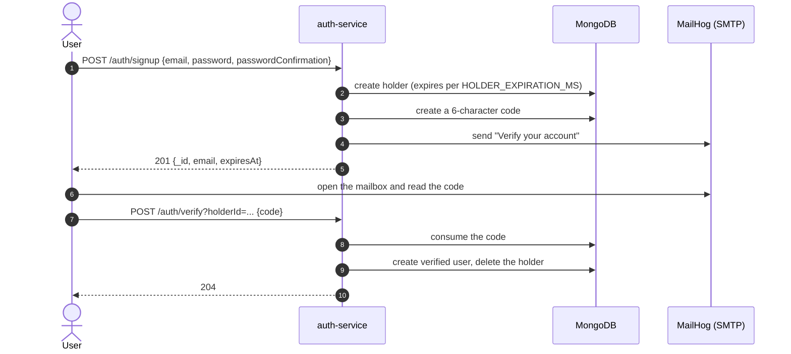

# Sign up and verify an email

This flow creates an account from scratch: a `POST /auth/signup` call stores a
temporary holder, the service mails a verification code, and `POST /auth/verify`
turns the holder into a verified user. It is the only self-service way to obtain
an account: every other path starts from an owner or an app admin invitation.

You finish with a user that can log in, but with no access to any application
yet: grants are given by an owner or an app admin in the application bootstrap
flow.

## Access levels used here

| Route               | Access | Notes                                 |
| ------------------- | ------ | ------------------------------------- |
| `POST /auth/signup` | Public | Rate-limited and single-use per email |
| `POST /auth/verify` | Public | Consumes the emailed code, valid once |

Neither route requires a token, and neither returns one.

## Flow at a glance



## 1. Sign up

```bash
curl -s -X POST http://localhost:3000/auth/signup \
  -H 'Content-Type: application/json' \
  -d '{"email":"newcomer@example.com","password":"Newcomer123!","passwordConfirmation":"Newcomer123!"}'
```

```json
{
  "email": "newcomer@example.com",
  "_id": "65f1c0a2b7d4e90012a3b4d0",
  "expiresAt": "2026-01-01T10:05:00.000Z",
  "createdAt": "2026-01-01T10:00:00.000Z",
  "updatedAt": "2026-01-01T10:00:00.000Z"
}
```

- `201` with the holder: no tokens, no password, and `_id` is the `holderId`
  the verification needs.
- The password follows the same rule as everywhere else: 8+ characters with a
  lowercase letter, an uppercase letter, a digit and a symbol.
- The holder lives for `HOLDER_EXPIRATION_MS` (one hour when unset; five
  minutes with the shipped `.env.example`). After that MongoDB removes it and
  the signup must be repeated.
- If the email cannot be sent, the holder and the code are deleted, so a failed
  delivery never leaves a half-created account behind.

Keep the id:

```bash
HOLDER_ID="<_id from the response>"
```

## 2. Read the verification code

Locally the service sends mail to MailHog instead of a real SMTP server, so
open <http://localhost:8025> and the message with the subject
`Verify your account` is there.

To read it without leaving the terminal:

```bash
curl -s "http://localhost:8025/api/v2/messages?limit=1"
```

The code is six characters from `A` to `Z` and `0` to `9` (for example
`S89U3D`), not a numeric PIN. It is single-use and expires after
`CODE_EXPIRATION_MS` (one hour when unset; five minutes with the shipped
`.env.example`).

Reminder: the code is a credential. Do not paste a real one into an issue or a
chat, and do not reuse an example code: it only works with the holder that
generated it.

## 3. Verify the email

```bash
curl -s -o /dev/null -w '%{http_code}\n' \
  -X POST "http://localhost:3000/auth/verify?holderId=$HOLDER_ID" \
  -H 'Content-Type: application/json' \
  -d '{"code":"S89U3D"}'
```

`204` with no body. Under the hood the code is consumed, a verified user is
created with the holder's email and password, and the holder is deleted.

Calling it a second time returns `400`, because the code was already used:

```json
{
  "message": "The provided code is invalid, used or expired",
  "code": "INVALID_CODE"
}
```

## 4. Check the result

An account that has not been verified is a holder, not a user, so it cannot log
in yet. Before verifying, `POST /auth/login` answers with the generic credential
error:

```json
{ "message": "Invalid email or password", "code": "INVALID_CREDENTIALS" }
```

After verifying, the same credentials are accepted as long as the account has a
grant on the application. The next flow exchanges them for access and refresh
tokens.

## Troubleshooting

| Symptom                                                                                 | Cause                                                                                                                     |
| --------------------------------------------------------------------------------------- | ------------------------------------------------------------------------------------------------------------------------- |
| `400 {"message":"The provided code is invalid, used or expired","code":"INVALID_CODE"}` | The code was already used, expired, or does not belong to that `holderId`                                                 |
| `400 {"message":"Invalid email or password","code":"INVALID_ARGUMENT"}` on signup       | That email already belongs to a holder or a user; the message stays generic on purpose                                    |
| `400 Password does not meet complexity requirements`                                    | The password lacks an uppercase letter, a lowercase letter, a digit, a symbol or 8 characters                             |
| `401 {"message":"Invalid email or password","code":"INVALID_CREDENTIALS"}` on login     | The account was not verified yet, or the password is wrong: the response is identical                                     |
| No email in MailHog                                                                     | `SMTP_HOST`/`SMTP_PORT` do not point at MailHog, or the signup was rate-limited before sending                            |
| `429` on signup                                                                         | `RATE_LIMIT_SIGNUP_MAX` signups per `RATE_LIMIT_SIGNUP_WINDOW_MS` (3 per hour when unset; 15 per 5 s with `.env.example`) |

## What's next

The account exists and is verified. Continue with [Log in, call the API and
refresh the token](login-and-refresh.md) to exchange its credentials for access
and refresh tokens, use the access token and rotate the refresh token.
